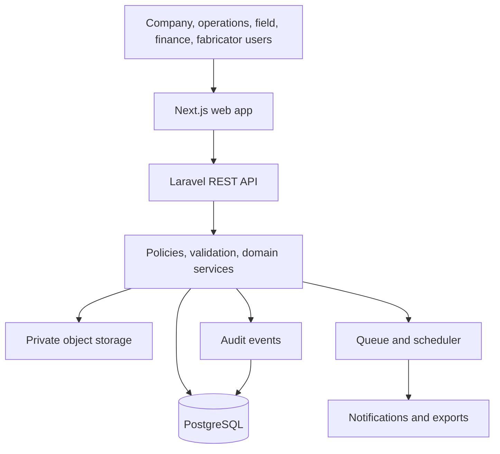

# Architecture — Manikstu Agro Operations Platform
**Status:** Proposed, not implemented | **Updated:** 2026-10-16

## Proposed tech stack
- Web: Next.js 16, React 19, TypeScript.
- Styling/components: Tailwind CSS 4 and documented accessible components.
- API: Laravel 13 REST API.
- Database: PostgreSQL.
- Media: private S3-compatible object storage; metadata in PostgreSQL.
- Async: Laravel queues and scheduler for reminders, exports and checks.
- Tests: API/domain tests plus frontend unit/component tests.
- Environments: development, staging, production. Validate version compatibility, hosting and CI/CD before implementation.

## App flow
1. User authenticates. 2. API resolves role and permitted projects. 3. User opens company dashboard/project workspace. 4. UI opens/searches a record. 5. API validates input, permission and lifecycle state. 6. Database transaction commits related changes. 7. Audit event records critical change. 8. Background jobs handle notifications/exports. 9. UI reports success or actionable failure.



## Core entities
Organization; User/Role/Permission/UserProjectAccess; Project/ProjectType/StageDefinition; Beneficiary/Farmer; ApprovedWork; Site/Asset/Shed; SiteAssessment; StageTransition; Contractor/Fabricator; WorkOrder/Revision/Assignment; Material/Warehouse/StockMovement/SiteMaterialMovement; Receipt/Expense/Disbursement/Commitment/AdvanceAllocation/Reconciliation; Task/Issue/Decision/Approval; Document/MediaMetadata; Inspection/Defect/CorrectiveAction; AuditEvent/Notification.

Keep Beneficiary, ApprovedWork and Site/Shed separate so replacement/reassignment preserves history.

## Data and finance rules
Use UUID primary keys and human-readable codes; `numeric/decimal` for money; foreign keys, uniqueness constraints and transactions; no hard-delete of financial history—use reversals/adjustments. Keep approved budget, verified receipts, expenses/disbursements, commitments and reconciliation separate. Finance must approve accounting definitions before formulas are implemented. Sanctioned budget is not the same as cash received.

## Authorization and security
Enforce authorization server-side. Fabricators access assigned work only. Separate transaction entry and verification where required. Fabricators cannot approve their own completion/payment. Work-order revisions and reassignment need configured authorization. Audit actor, timestamp, entity, action, relevant before/after values and reason. Keep media private and use authorized short-lived links.

## Proposed folder structure
```text
manikstu-ops/
├── apps/web/
│   ├── app/(auth)/
│   ├── app/(workspace)/{dashboard,projects,beneficiaries,sites,work-orders,materials,finance,tasks,documents,reports}/
│   ├── components/{ui,forms,tables,navigation}/
│   ├── features/  lib/  hooks/  types/  tests/
├── apps/api/
│   ├── app/{Http/Controllers/Api,Http/Requests,Policies,Models,Services,Actions,Jobs,Notifications}/
│   ├── database/migrations/  routes/api.php  tests/
├── packages/{shared-types,config}/
├── docs/{PRD.md,ARCHITECTURE.md,RULES.md,PHASES.md,DESIGN.md,MEMORY.md}
└── infra/{deployment,backup}/
```
This monorepo structure is a proposal; separate repositories are also possible.

## API and reliability
Version API routes; use centralized validation, consistent error codes, pagination and whitelisted filters/sorts. Use idempotency for retry-prone financial actions. Never trust client totals or role claims. Separate environments/secrets, monitor errors, define file limits/retention, and test restoration from backups.

## Open decisions
Hosting, authentication/SSO, component library, repository layout, backup targets, retention, offline sync, WhatsApp provider, localization and finance policy.
